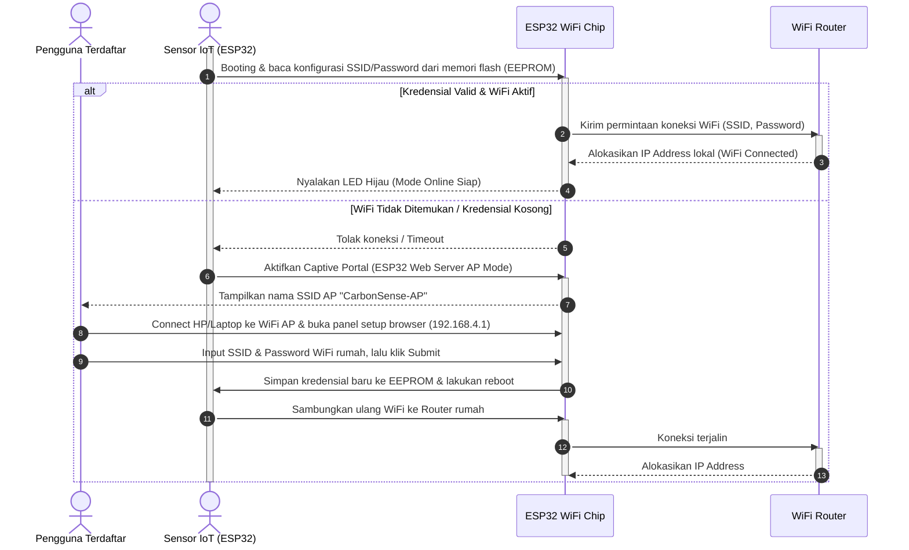
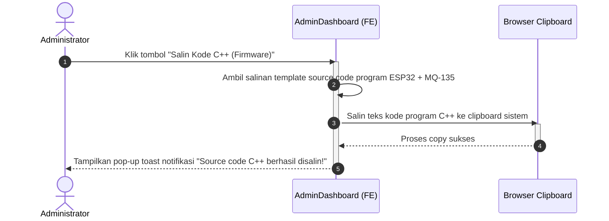

# Kumpulan Sequence Diagram Lengkap (CarbonSense)

Dokumen ini berisi kumpulan **Sequence Diagram** lengkap dalam format **Mermaid** untuk seluruh fungsionalitas (*use cases*) yang terdapat pada rancangan diagram sistem **CarbonSense**. Masing-masing diagram dipisahkan secara detail dengan disertai penomoran judul sub-bab serta penomoran Gambar yang disesuaikan secara akademis untuk laporan akhir Anda.

---

## Daftar Lifeline & Aktor Utama

Aktor dan komponen sistem yang terlibat dalam diagram di bawah ini meliputi:
1.  **Pengguna Terdaftar (User)**: Aktor pengguna utama pemilik/penghuni ruangan.
2.  **Administrator (Admin)**: Pengelola registrasi dan inventori perangkat.
3.  **Sensor IoT (MQ-135)**: Perangkat keras ESP32 fisik.
4.  **Frontend (FE)**: Antarmuka web klien (React + Vite + TypeScript).
5.  **Backend (BE)**: Server Express.js.
6.  **PostgreSQL (Supabase)**: Database relasional utama.
7.  **Firebase RTDB**: Database real-time untuk sinkronisasi telemetri.
8.  **Gemini API (Cloud)**: Layanan AI untuk rekomendasi mitigasi.
9.  **SMTP Mail Server**: Server e-mail pengirim notifikasi.

---

## BAGIAN A: Aktor Pengguna Terdaftar (User)
### 3.2.4.1 Fungsionalitas Registrasi Akun Baru & Onboarding
1. Gambar 3.4 menampilkan Sequence Diagram Fungsionalitas Registrasi Akun Baru & Onboarding, mulai dari pengisian data pada form pendaftaran hingga penyimpanan data pengguna ke database Supabase, serta redireksi otomatis ke pengisian kuesioner onboarding profil kesehatan.

```mermaid
sequenceDiagram
    autonumber
    actor User as Pengguna Terdaftar
    participant FE as RegisterPage/Onboarding (FE)
    participant BE as Server/Express (BE)
    database DB as PostgreSQL (Supabase)
    participant LS as LocalStorage (Browser)

    User->>FE: Isi username, email, password & klik Daftar
    activate FE
    alt Validasi input gagal (password < 6 karakter)
        FE-->>User: Tampilkan pesan error validasi (Registrasi Diblokir)
    else Validasi input sukses (password >= 6 karakter)
        FE->>BE: POST /api/auth/register { username, email, password }
        activate BE
        BE->>DB: Cari user berdasarkan email
        activate DB
        DB-->>BE: Email belum terdaftar (Valid)
        deactivate DB
        BE->>BE: Enkripsi password dengan bcrypt (salt 10)
        BE->>DB: INSERT INTO "Users" (username, email, password, role='user')
        activate DB
        DB-->>BE: Data user baru tersimpan
        deactivate DB
        BE-->>FE: Response JSON (Token JWT & User Info, 201 Created)
        deactivate BE
        FE->>User: Alihkan otomatis ke halaman kuesioner Onboarding
        
        User->>FE: Isi kuesioner (lokasi, ventilasi, kelompok rentan) & klik Simpan
        FE->>LS: Simpan jawaban kuesioner ke key 'cs_onboarding_answers'
        activate LS
        LS-->>FE: Sukses menyimpan
        deactivate LS
        FE->>LS: Set status onboarding 'cs_onboarding_completed' = 'true'
        activate LS
        LS-->>FE: Sukses menyimpan
        deactivate LS
        FE-->>User: Alihkan ke Halaman Select Device (Tautkan Alat)
    end
    deactivate FE
```

---

### 3.2.4.2 Fungsionalitas Login Pengguna & Autentikasi Sesi
2. Gambar 3.5 menampilkan Sequence Diagram Fungsionalitas Login Pengguna & Autentikasi Sesi, mulai dari pengisian email dan password hingga verifikasi data pada database Supabase, penerbitan token JWT, dan pemrosesan otentikasi sesi lokal.

```mermaid
sequenceDiagram
    autonumber
    actor User as Pengguna Terdaftar
    participant FE as LoginPage (FE)
    participant BE as Server/Express (BE)
    database DB as PostgreSQL (Supabase)
    participant LS as LocalStorage (Browser)

    User->>FE: Masukkan email & password & klik Login
    activate FE
    FE->>BE: POST /api/auth/login { email, password }
    activate BE
    BE->>DB: Cari user berdasarkan email
    activate DB
    DB-->>BE: Data user ditemukan
    deactivate DB
    BE->>BE: Bandingkan password dengan bcrypt.compare()
    alt Kredensial Salah
        BE-->>FE: Response JSON (Error 400: Kredensial Salah)
        deactivate BE
        FE-->>User: Tampilkan alert pesan kegagalan login
    else Kredensial Benar
        BE-->>FE: Response JSON (Token JWT & User info, 200 OK)
        deactivate BE
        FE->>LS: Simpan Token ('cs_user_token') & info user di localStorage
        activate LS
        LS-->>FE: Sukses menyimpan
        deactivate LS
        FE->>User: Alihkan ke halaman Select Device / Dashboard
    end
    deactivate FE
```

---

### 3.2.4.3 Fungsionalitas Penautan Perangkat (QR Code & Validasi ID)
3. Gambar 3.6 menampilkan Sequence Diagram Fungsionalitas Penautan Perangkat (QR Code & Validasi ID), mulai dari scanning QR code atau input ID manual hingga proses pengecekan keabsahan alat di database PostgreSQL dan pembaruan kepemilikan alat di PostgreSQL serta Firebase RTDB.

```mermaid
sequenceDiagram
    autonumber
    actor User as Pengguna Terdaftar
    participant FE as SelectDevicePage (FE)
    participant BE as Server/Express (BE)
    database DB as PostgreSQL (Supabase)
    database FB as Firebase RTDB
    participant LS as LocalStorage (Browser)

    alt Metode Input Manual
        User->>FE: Input Device ID (e.g. CS-DAPUR-01) & klik Submit
    else Metode Scan QR Code
        User->>FE: Scan QR Code alat via Kamera laptop/hp
    end
    activate FE
    FE->>FE: Parsing parameter URL/Device ID (e.g. CS-DAPUR-01)
    FE->>BE: GET /api/devices/check/{deviceId} (Cek keabsahan)
    activate BE
    BE->>DB: SELECT * FROM "Devices" WHERE id = deviceId
    activate DB
    DB-->>BE: Data alat ditemukan
    deactivate DB
    BE-->>FE: Response JSON (Detail perangkat terdaftar)
    deactivate BE
    
    alt Device ID Ilegal / Tidak Terdaftar di DB
        FE-->>User: Tampilkan pesan error "Perangkat tidak valid!"
    else Device ID Valid
        FE->>User: Aktifkan tombol "Tautkan Alat"
        User->>FE: Klik tombol "Tautkan Perangkat"
        FE->>BE: POST /api/devices/bind { deviceId, userEmail }
        activate BE
        BE->>DB: UPDATE "Devices" SET userEmail = userEmail, status = 'Online', ppm = '0' WHERE id = deviceId
        activate DB
        DB-->>BE: Update database lokal sukses
        deactivate DB
        BE->>FB: PATCH /deviceId.json { userEmail, status: 'Online', nilai_ppm: 0 }
        activate FB
        FB-->>BE: Sinkronisasi Firebase Sukses
        deactivate FB
        BE-->>FE: Response JSON (Perangkat berhasil ditautkan, 200 OK)
        deactivate BE
        FE->>LS: Hapus pending device ID dari localStorage
        activate LS
        LS-->>FE: Sukses menghapus
        deactivate LS
        FE-->>User: Alihkan ke halaman Dashboard Utama
    end
    deactivate FE
```

---

### 3.2.4.4 Fungsionalitas Dashboard Utama & Monitoring Real-Time (Firebase WebSocket)
4. Gambar 3.7 menampilkan Sequence Diagram Fungsionalitas Dashboard Utama & Monitoring Real-Time (Firebase WebSocket), mulai dari pembukaan halaman dashboard utama hingga inisialisasi WebSocket ke Firebase RTDB, penarikan data snapshot awal, dan update grafik secara real-time.

```mermaid
sequenceDiagram
    autonumber
    actor User as Pengguna Terdaftar
    participant FE as DashboardPage (FE)
    participant LS as LocalStorage (Browser)
    database FB as Firebase RTDB

    User->>FE: Akses Halaman Dashboard Utama
    activate FE
    FE->>LS: Baca email pengguna & deviceId yang ditautkan
    activate LS
    LS-->>FE: Return email & deviceId
    deactivate LS
    FE->>FB: Hubungkan listener WebSocket (onValue) ke path /{deviceId}.json
    activate FB
    FB-->>FE: Kirim data snapshot awal (nilai_ppm, status, lastActive, dll.)
    deactivate FB
    FE->>FE: Render komponen metrik & status koneksi di layar
    FE-->>User: Tampilkan dashboard awal
    deactivate FE
    
    Note over FB, FE: Aliran Data Real-Time Berjalan
    FB->>FE: Push event pembaruan telemetri (e.g. nilai_ppm = 450, status = 'Online')
    activate FE
    FE->>FE: Perbarui state React (ppm, status)
    FE->>FE: Re-render komponen Gauge dan tambahkan data baru ke grafik tren
    FE-->>User: Tampilkan grafik & angka kualitas udara ter-update secara real-time
    deactivate FE
```

---

### 3.2.4.5 Fungsionalitas Histori Data & Ekspor Laporan (PDF/Excel)
5. Gambar 3.8 menampilkan Sequence Diagram Fungsionalitas Histori Data & Ekspor Laporan (PDF/Excel), mulai dari pemilihan rentang tanggal historis pada DatePicker, pemanggilan data ke database PostgreSQL, hingga pengunduhan berkas rekap PDF/XLSX.

```mermaid
sequenceDiagram
    autonumber
    actor User as Pengguna Terdaftar
    participant FE as DashboardPage (FE)
    participant BE as Server/Express (BE)
    database DB as PostgreSQL (Supabase)
    participant xlsx as Library SheetJS (Local)
    participant jspdf as Library jsPDF (Local)

    User->>FE: Pilih tanggal pada DatePicker (e.g. 2026-06-15)
    activate FE
    FE->>BE: GET /api/devices/history?date=2026-06-15&deviceId=CS-DAPUR-01
    activate BE
    BE->>DB: SELECT * FROM "DeviceLogs" WHERE deviceId = deviceId AND date = terpilih
    activate DB
    DB-->>BE: Kembalikan data histori PPM harian
    deactivate DB
    BE-->>FE: Response JSON (Array log telemetri harian)
    deactivate BE
    FE->>FE: Perbarui grafik tren kualitas udara harian
    FE-->>User: Grafik ter-update di layar
    
    alt Opsi Ekspor Excel (.xlsx)
        User->>FE: Klik tombol "Ekspor Excel"
        FE->>xlsx: Generate workbook (.xlsx) dari data histori
        activate xlsx
        xlsx-->>FE: Berkas biner Excel siap diunduh
        deactivate xlsx
        FE-->>User: Unduh otomatis berkas 'carbonsense_report.xlsx'
    else Opsi Ekspor PDF (.pdf)
        User->>FE: Klik tombol "Ekspor PDF"
        FE->>jspdf: Gambar layout PDF dengan plugin jspdf-autotable
        activate jspdf
        jspdf-->>FE: Berkas PDF siap diunduh
        deactivate jspdf
        FE-->>User: Unduh otomatis berkas 'carbonsense_report.pdf'
    end
    deactivate FE
```

---

### 3.2.4.6 Fungsionalitas Analisis Mitigasi Kedaruratan AI & Pengaturan Sensitivitas
6. Gambar 3.9 menampilkan Sequence Diagram Fungsionalitas Analisis Mitigasi Kedaruratan AI & Pengaturan Sensitivitas, mulai dari penyesuaian parameter kelompok sensitif di pengaturan, pembaruan threshold bahaya, hingga pemrosesan data anomali karbon oleh Gemini AI untuk menghasilkan narasi rekomendasi darurat.

```mermaid
sequenceDiagram
    autonumber
    actor User as Pengguna Terdaftar
    participant FE as Settings/Dashboard (FE)
    participant BE as Server/Express (BE)
    database DB as PostgreSQL (Supabase)
    participant AI as Gemini API (Cloud)

    User->>FE: Pilih kelompok rentan (Asma/Bayi) & klik Simpan
    activate FE
    FE->>BE: PUT /api/user/settings { email, vulnerability: 'asthma' }
    activate BE
    BE->>DB: UPDATE "Users" SET vulnerability = 'asthma' WHERE email = email
    activate DB
    DB-->>BE: Update database sukses
    deactivate DB
    BE-->>FE: Response JSON (200 OK)
    deactivate BE
    FE->>FE: Turunkan batas aman alarm PPM secara protektif (e.g. dari 1000 ke 700 PPM)
    FE-->>User: Pengaturan sensitivitas berhasil diterapkan
    deactivate FE
    
    Note over FE: Skenario: Kadar gas PPM melebih batas baru (>700 PPM)
    FE->>FE: Aktifkan alarm visual merah di Dashboard
    activate FE
    FE->>BE: POST /api/ai/recommendation { ppm: 850, vulnerability: 'asthma' }
    activate BE
    BE->>AI: POST /v1/models/gemini-pro:generateContent { prompt dan konteks }
    activate AI
    AI-->>BE: Rekomendasi keselamatan (Teks Markdown)
    deactivate AI
    BE-->>FE: Response JSON { recommendation: teks_mitigasi }
    deactivate BE
    FE->>FE: Render teks mitigasi Gemini AI pada modal darurat
    FE-->>User: Tampilkan modal alarm keselamatan AI
    deactivate FE
```

---


---

## BAGIAN B: Aktor Sensor IoT (MQ-135)

### 3.2.4.7 Fungsionalitas Inisialisasi WiFi Jaringan Sensor (ESP32 Captive Portal)
7. Gambar 3.10 menampilkan Sequence Diagram Fungsionalitas Inisialisasi WiFi Jaringan Sensor (ESP32 Captive Portal), mulai dari booting mikrokontroler ESP32, penanganan kegagalan koneksi WiFi lokal, inisialisasi captive portal hotspot, hingga penginputan kredensial baru melalui browser pengguna.



---

### 3.2.4.8 Fungsionalitas Transmisi Telemetri, Waktu Aktif, & Heartbeat Sensor
8. Gambar 3.11 menampilkan Sequence Diagram Fungsionalitas Transmisi Telemetri, Waktu Aktif, & Heartbeat Sensor, mulai dari transmisi data PPM oleh sensor IoT ESP32 ke server Express, pencatatan timestamp lastActive, serta inkrementasi counter ping heartbeat pada Firebase RTDB.

```mermaid
sequenceDiagram
    autonumber
    actor IoT as Sensor IoT (ESP32)
    participant BE as Server/Express (BE)
    database DB as PostgreSQL (Supabase)
    database FB as Firebase RTDB

    activate IoT
    IoT->>BE: POST /api/devices/telemetry { id: 'CS-DAPUR-01', ppm: 450, status: 'Online' }
    activate BE
    BE->>DB: SELECT * FROM "Devices" WHERE id = deviceId
    activate DB
    DB-->>BE: Perangkat valid
    deactivate DB
    BE->>BE: Dapatkan timestamp waktu server saat ini (lastActive)
    BE->>DB: UPDATE "Devices" SET ppm = 450, status = 'Online', lastActive = timestamp WHERE id = id
    activate DB
    DB-->>BE: Database lokal ter-update
    deactivate DB
    
    BE->>FB: GET /CS-DAPUR-01.json (ambil indeks ping saat ini)
    activate FB
    FB-->>BE: Mengembalikan nilai ping (misal: ping = 100)
    deactivate FB
    BE->>FB: PATCH /CS-DAPUR-01.json { nilai_ppm: 450, status: 'Online', lastActive: timestamp, ping: 101 }
    activate FB
    FB-->>BE: Sinkronisasi Firebase RTDB Sukses
    deactivate FB
    BE-->>IoT: Response 200 OK (Telemetry & Heartbeat Updated)
    deactivate BE
    deactivate IoT
```

---

### 3.2.4.9 Fungsionalitas Deteksi Offline Otomatis & Notifikasi Email Sistem
9. Gambar 3.12 menampilkan Sequence Diagram Fungsionalitas Deteksi Offline Otomatis & Notifikasi Email Sistem, mulai dari pengecekan periodik keaktifan alat oleh cron job server, pengubahan status menjadi Offline jika terdeteksi tidak aktif selama 5 menit, hingga pengiriman email otomatis melalui SMTP server.

```mermaid
sequenceDiagram
    autonumber
    participant BE as Server/Express (BE)
    database DB as PostgreSQL (Supabase)
    database FB as Firebase RTDB
    participant SMTP as SMTP Mail Server
    actor User as Pengguna Terdaftar

    Note over BE: Pemicu: Cron Job Pengecekan Aktif (Setiap 5 menit)
    BE->>DB: SELECT * FROM "Devices" WHERE status != 'Offline'
    activate BE
    activate DB
    DB-->>BE: Mengembalikan daftar alat aktif
    deactivate DB
    
    loop Per Perangkat Aktif
        BE->>BE: Bandingkan waktu sekarang dengan timestamp "updatedAt" perangkat
        alt Selisih waktu > 5 menit (Tidak ada ping)
            BE->>DB: UPDATE "Devices" SET status = 'Offline', ppm = '--', lastActive = '5 menit yang lalu' WHERE id = id
            activate DB
            DB-->>BE: Update database PostgreSQL selesai
            deactivate DB
            BE->>FB: PATCH /deviceId.json { status: 'Offline', lastActive: '5 menit yang lalu' }
            activate FB
            FB-->>BE: Sync Firebase RTDB selesai
            deactivate FB
            
            BE->>DB: SELECT userEmail FROM "Devices" WHERE id = id
            activate DB
            DB-->>BE: userEmail ditemukan (e.g. budi@example.com)
            deactivate DB
            BE->>SMTP: Kirim Email Peringatan ("Alat CS-DAPUR-01 Terputus / Offline")
            activate SMTP
            SMTP->>User: Kirim email pemberitahuan ke inbox pengguna
            deactivate SMTP
        end
    end
    deactivate BE
```

---


---

## BAGIAN C: Aktor Administrator (Admin)

### 3.2.4.10 Fungsionalitas Autentikasi & Dashboard Utama Admin (Search & Device Monitoring)
10. Gambar 3.13 menampilkan Sequence Diagram Fungsionalitas Autentikasi & Dashboard Utama Admin (Search & Device Monitoring), mulai dari proses login admin menggunakan pencocokan env file server, inisialisasi konsol dasbor admin untuk memuat seluruh inventori alat, dan fitur search filter di sisi klien.

```mermaid
sequenceDiagram
    autonumber
    actor Admin as Administrator
    participant FE as AdminDashboard (FE)
    participant BE as Server/Express (BE)
    database DB as PostgreSQL (Supabase)
    participant LS as LocalStorage (Browser)

    Admin->>FE: Masukkan Admin ID & password pada form login admin, lalu klik Login
    activate FE
    FE->>BE: POST /api/auth/admin-login { email, password }
    activate BE
    BE->>BE: Dapatkan nilai ADMIN_ID & ADMIN_PASSWORD dari berkas lingkungan (.env)
    alt Kredensial Salah
        BE-->>FE: Response JSON (Error 401: Admin ID atau Password salah)
        deactivate BE
        FE-->>Admin: Tampilkan pesan kegagalan otentikasi admin
    else Kredensial Benar
        BE-->>FE: Response JSON (Token JWT Admin, 200 OK)
        deactivate BE
        FE->>LS: Simpan admin token di localStorage
        activate LS
        LS-->>FE: Sukses menyimpan
        deactivate LS
        FE->>FE: Alihkan ke halaman /admin/dashboard
        
        FE->>BE: GET /api/devices (Request seluruh daftar perangkat)
        activate BE
        BE->>DB: SELECT * FROM "Devices" ORDER BY "createdAt" DESC
        activate DB
        DB-->>BE: Kembalikan daftar baris perangkat
        deactivate DB
        BE-->>FE: Response JSON (Daftar semua perangkat)
        deactivate BE
        FE->>FE: Render tabel manajemen perangkat
        FE-->>Admin: Tampilkan dasbor perangkat terdaftar
        
        Admin->>FE: Masukkan kata kunci pencarian di input field (e.g. "CS-KAMAR")
        FE->>FE: Lakukan filter list data pada memory internal React (filter row)
        FE-->>Admin: Tampilkan baris tabel yang cocok secara real-time
    end
    deactivate FE
```

---

### 3.2.4.11 Fungsionalitas Manajemen Inventori Perangkat (CRUD Perangkat & QR Code Generation)
11. Gambar 3.14 menampilkan Sequence Diagram Fungsionalitas Manajemen Inventori Perangkat (CRUD Perangkat & QR Code Generation), mulai dari proses penambahan alat baru oleh admin, pembuatan QR code otomatis, pengubahan data email pengguna, dan penghapusan permanen data alat di database PostgreSQL.

```mermaid
sequenceDiagram
    autonumber
    actor Admin as Administrator
    participant FE as AdminDashboard (FE)
    participant BE as Server/Express (BE)
    database DB as PostgreSQL (Supabase)

    Admin->>FE: Akses menu manajemen perangkat
    activate FE
    alt Skenario C: Create Device Baru
        Admin->>FE: Input ID perangkat baru (e.g. CS-RUANG-05) & klik Simpan
        FE->>BE: POST /api/devices { id: 'CS-RUANG-05', status: 'Offline' }
        activate BE
        BE->>DB: INSERT INTO "Devices" (id, status='Offline')
        activate DB
        DB-->>BE: Record baru tersimpan
        deactivate DB
        BE-->>FE: Response JSON (Detail objek perangkat baru, 201 Created)
        deactivate BE
        FE->>FE: Generate QR Code dari data string ID perangkat
        FE-->>Admin: Tampilkan modal sukses beserta QR Code hasil pembuatan alat
    else Skenario U: Update Email Penautan Perangkat
        Admin->>FE: Klik Edit, ubah userEmail penautan alat, klik Simpan
        FE->>BE: PUT /api/devices/CS-RUANG-05 { userEmail: 'baru@example.com' }
        activate BE
        BE->>DB: UPDATE "Devices" SET userEmail = 'baru@example.com' WHERE id = id
        activate DB
        DB-->>BE: Update database sukses
        deactivate DB
        BE-->>FE: Response JSON (200 OK)
        deactivate BE
        FE->>FE: Refresh data list tabel perangkat
        FE-->>Admin: Tampilkan notifikasi perubahan sukses & perbarui tabel
    else Skenario D: Delete Perangkat Permanen
        Admin->>FE: Klik tombol Hapus alat & konfirmasi dialog hapus
        FE->>BE: DELETE /api/devices/CS-RUANG-05
        activate BE
        BE->>DB: DELETE FROM "Devices" WHERE id = id
        activate DB
        DB-->>BE: Hapus data dari PostgreSQL sukses
        deactivate DB
        BE-->>FE: Response JSON (Perangkat terhapus, 200 OK)
        deactivate BE
        FE->>FE: Hapus baris perangkat dari tampilan tabel
        FE-->>Admin: Tampilkan notifikasi "Perangkat berhasil dihapus"
    end
    deactivate FE
```

---

### 3.2.4.12 Fungsionalitas Penyalinan Source Code Firmware Mikrokontroler
12. Gambar 3.15 menampilkan Sequence Diagram Fungsionalitas Penyalinan Source Code Firmware Mikrokontroler, mulai dari proses pengambilan template source code C++ program Arduino IDE dan penyalinan otomatis ke clipboard sistem operasi oleh administrator.



---
